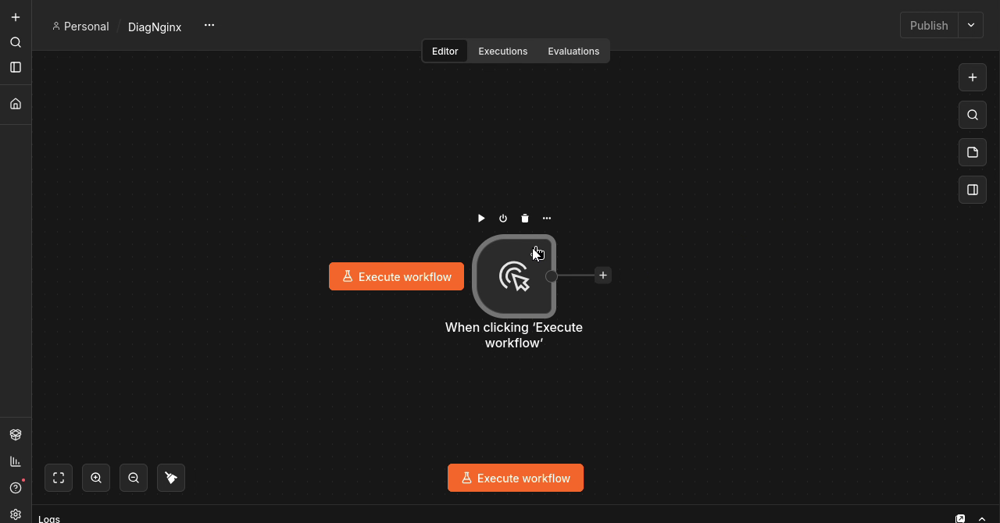
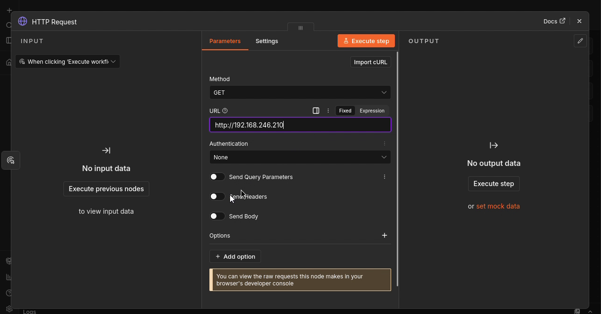
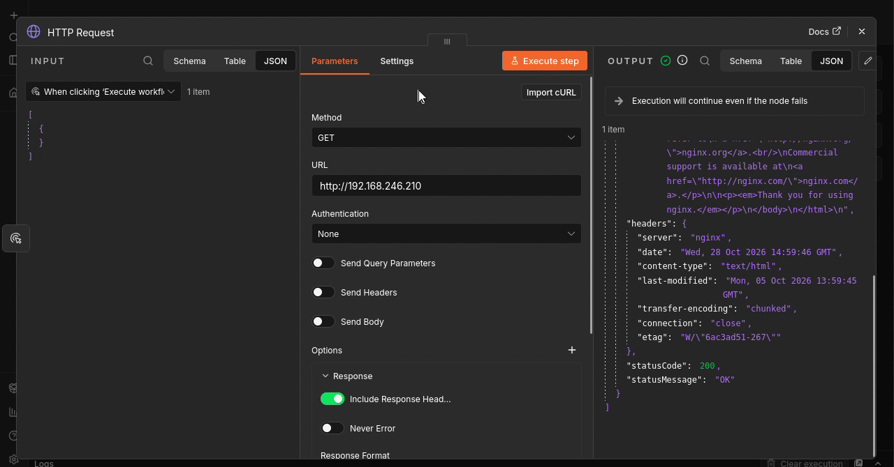

# Étape 1 — Créer le premier test HTTP

**Objectif :** Créer un workflow manuel et vérifier la réponse HTTP du serveur Nginx.

🎬 [Lire ou télécharger la vidéo commentée](videos/Etape-01-video-commentee.mp4)

<video controls preload="metadata" width="960" src="videos/Etape-01-video-commentee.mp4">
  <a href="videos/Etape-01-video-commentee.mp4">Ouvrir la vidéo commentée</a>
</video>

## 1. Créer le workflow et son déclencheur

1. Nommer le workflow DiagNginx.
2. Cliquer sur Add first step, puis Trigger manually.
3. Utiliser ce déclencheur pour lancer les essais à la demande.

*Capture à 00:19 dans la vidéo de cette étape (source complète : 00:19).*

**À retenir :** Le test part de n8n : le serveur doit être accessible depuis son environnement d’exécution.

## 2. Configurer la requête HTTP

1. Ajouter HTTP Request à la sortie du déclencheur.
2. Choisir GET et saisir http://192.168.246.210.
3. Conserver Authentication : None pour la page de test du laboratoire.

*Capture à 00:41 dans la vidéo de cette étape (source complète : 00:41).*

**À retenir :** Adapter l’adresse IP à votre installation. GET demande le contenu de la page.

## 3. Récupérer et tester la réponse

1. Dans Options > Response, activer Include Response Headers and Status.
2. Conserver Response Format : Autodetect et Never Error désactivé.
3. Dans Settings, régler On Error sur Continue.
4. Exécuter le nœud et repérer statusCode : 200 et statusMessage : OK.

*Capture à 01:08 dans la vidéo de cette étape (source complète : 01:08).*

**À retenir :** Continue permet de poursuivre après une erreur ; ce réglage ne transforme pas un échec en succès.

**Validation :** reproduire les manipulations et examiner les données retournées avant de passer à l’étape suivante.

[Retour au sommaire](README.md)
