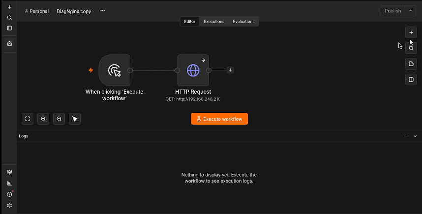
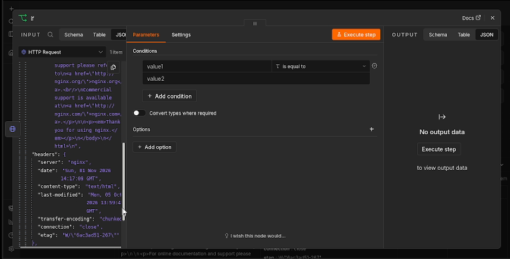
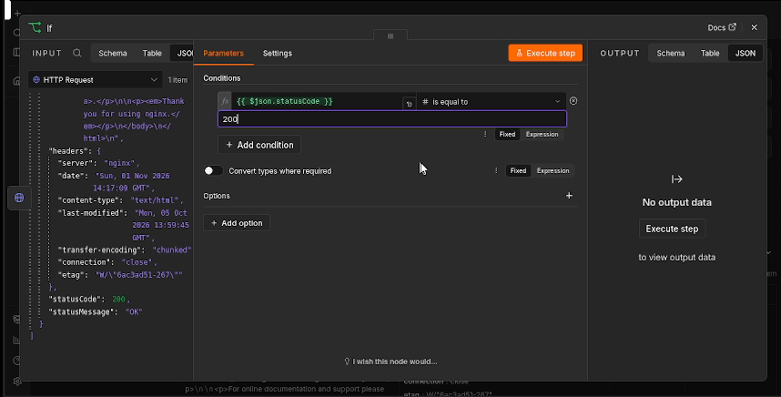
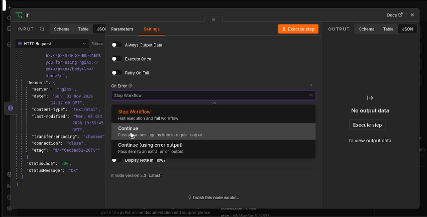
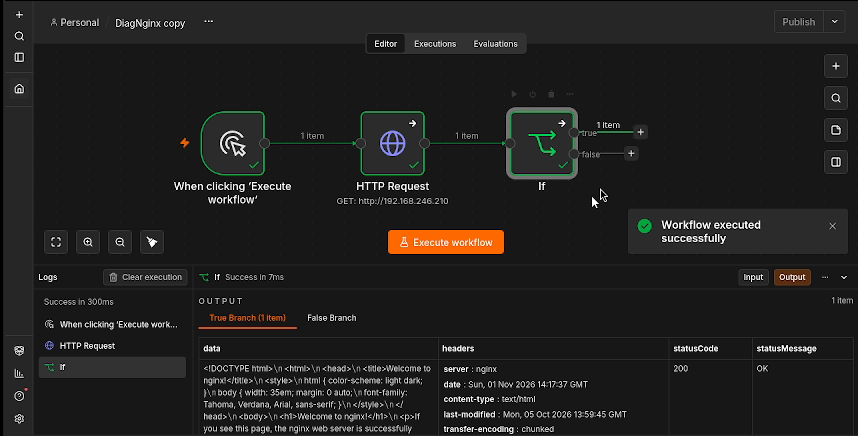
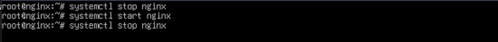
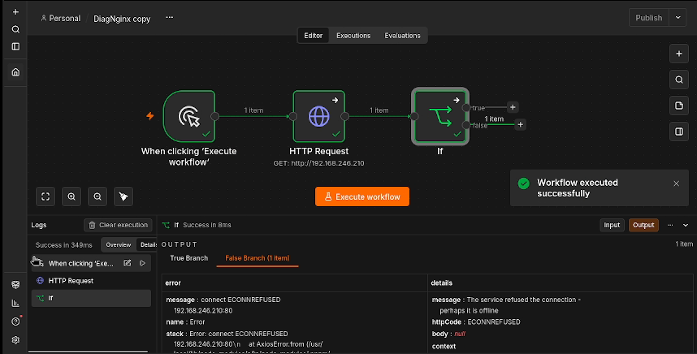

# Étape 2 — Configurer IF et tester l’arrêt de Nginx

**Objectif :** Comparer le code HTTP à 200, puis vérifier les branches true et false en arrêtant volontairement Nginx.

🎬 [Lire ou télécharger la vidéo commentée](videos/Etape-02-video-commentee.mp4)

<video controls preload="metadata" width="960" src="videos/Etape-02-video-commentee.mp4">
  <a href="videos/Etape-02-video-commentee.mp4">Ouvrir la vidéo commentée</a>
</video>

Version corrigée du 1er novembre 2026 : la commande d’arrêt du service est montrée avant le test d’échec.

## 1. Ajouter le nœud IF

À droite de **HTTP Request**, cliquez sur **+**, recherchez **IF** et sélectionnez-le. Le flux devient : déclencheur manuel → HTTP Request → IF.



*Capture à 00:02 dans la vidéo de cette étape.*

## 2. Charger les données de la requête

Exécutez les étapes précédentes, puis ouvrez IF. Dans **INPUT / JSON**, repérez **statusCode**. Le premier résultat contient ici la valeur **200** et le message **OK**.



*Capture à 00:28 dans la vidéo de cette étape.*

## 3. Comparer statusCode à 200

Dans **Parameters**, utilisez **{{ $json.statusCode }}** comme première valeur. Sélectionnez le type **Number** et **is equal to**, puis saisissez **200** comme seconde valeur.



*Capture à 00:39 dans la vidéo de cette étape.*

## 4. Repérer le réglage de gestion des erreurs

La vidéo sélectionne **Settings → On Error → Continue** sur IF. Ce réglage concerne les erreurs de ce nœud. Pour que les erreurs réseau parviennent à IF, **HTTP Request** doit lui aussi continuer en cas d’erreur, comme préparé à l’étape 1.



*Capture à 00:45 dans la vidéo de cette étape.*

## 5. Réponse HTTP 200 : branche true

Lancez **Execute workflow**. Le premier test affiche **True Branch (1 item)** avec **statusCode = 200**. Cette page répond correctement ; cela ne valide pas tous les services du serveur.



*Capture à 00:51 dans la vidéo de cette étape.*

## 6. Arrêter Nginx pour simuler la panne

Ouvrez la console de la VM **NGINX**. Avec le compte **root**, exécutez **systemctl stop nginx**. Avec un compte autorisé utilisant sudo : **sudo systemctl stop nginx**. La commande doit être lancée sur le serveur web, pas sur le serveur n8n.



*Capture à 01:01 dans la vidéo de cette étape.*

## 7. Relancer le workflow et lire le résultat

Cliquez sur **Execute workflow**. La sortie affiche **False Branch (1 item)** avec **ECONNREFUSED** sur le port 80. Dans ce test, la panne a été provoquée par l’arrêt volontaire de Nginx.



*Capture à 01:11 dans la vidéo de cette étape.*

## Commandes du test

À exécuter sur le **serveur Nginx**, avec le compte root :

```bash
systemctl stop nginx
```

Avec un compte autorisé utilisant sudo :

```bash
sudo systemctl stop nginx
```

## Interpréter les résultats

| Résultat | Branche | Interprétation |
|---|---|---|
| `statusCode = 200` | `true` | La page demandée répond correctement. |
| `ECONNREFUSED` après l’arrêt de Nginx | `false` | La connexion au service web est refusée. |
| `Workflow executed successfully` | — | n8n a terminé son exécution ; ce message ne prouve pas que Nginx est disponible. |

## Après l’exercice : remettre le service en marche

Complément au tutoriel, non réalisé à la fin de cet extrait :

```bash
systemctl start nginx
```

Ou, avec un compte utilisant sudo :

```bash
sudo systemctl start nginx
```

Relancez ensuite le workflow : une réponse 200 doit revenir dans `true`. Si la suite du lab nécessite la panne, conservez le service arrêté jusqu’à la fin du diagnostic.

[Retour au sommaire](README.md)
