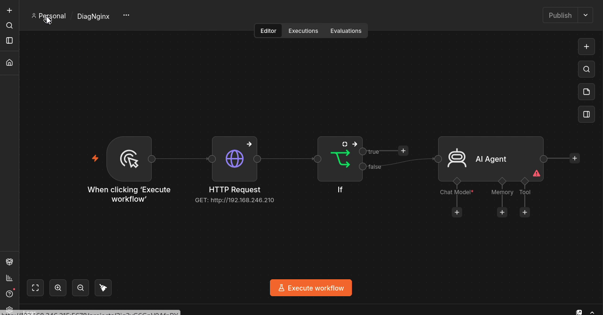
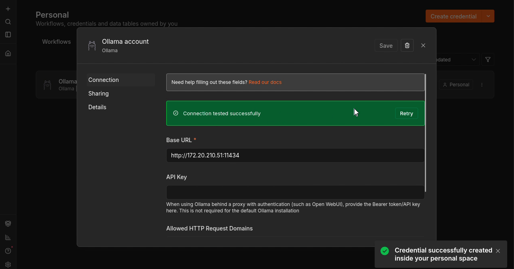
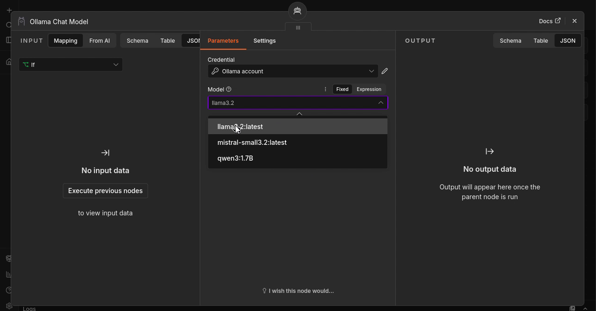

# Étape 3 — Connecter l’agent IA à Ollama

**Objectif :** Ajouter l’agent sur la branche de diagnostic et lui associer un modèle Ollama.

🎬 [Lire ou télécharger la vidéo commentée](videos/Etape-03-video-commentee.mp4)

<video controls preload="metadata" width="960" src="videos/Etape-03-video-commentee.mp4">
  <a href="videos/Etape-03-video-commentee.mp4">Ouvrir la vidéo commentée</a>
</video>

## 1. Ajouter l’agent sur la branche False

1. Ajouter AI Agent dans le workflow DiagNginx.
2. Relier la sortie False du nœud IF à l’entrée de l’agent.
3. Réserver la sortie True au cas où la réponse HTTP est conforme.

*Capture à 00:30 dans la vidéo de cette étape (source complète : 03:30).*

**À retenir :** Le raccordement prépare le diagnostic. Le prompt final de l’agent n’est pas saisi dans cette vidéo.

## 2. Créer la connexion Ollama

1. Dans Credentials, créer un identifiant de type Ollama.
2. Saisir la Base URL : http://172.20.210.51:11434.
3. Laisser API Key vide pour cette installation locale sans authentification.
4. Enregistrer et vérifier Connection tested successfully.

*Capture à 01:32 dans la vidéo de cette étape (source complète : 04:32).*

**À retenir :** Utiliser l’adresse de votre serveur Ollama, accessible depuis n8n. localhost désignerait l’environnement de n8n, pas nécessairement la machine Ollama.

## 3. Associer le modèle à l’agent

1. Depuis le connecteur Chat Model de AI Agent, ajouter Ollama Chat Model.
2. Sélectionner l’identifiant Ollama account.
3. Choisir un modèle disponible dans la liste ; la vidéo affiche notamment llama3.2:latest.
4. Vérifier le lien entre Ollama Chat Model et le connecteur Chat Model de l’agent.

*Capture à 02:04 dans la vidéo de cette étape (source complète : 05:04).*

**À retenir :** La connexion réussie valide l’accès à Ollama. L’appel effectif des outils par le modèle devra être testé une fois le prompt renseigné.

**Validation :** reproduire les manipulations et examiner les données retournées avant de passer à l’étape suivante.

[Retour au sommaire](README.md)
