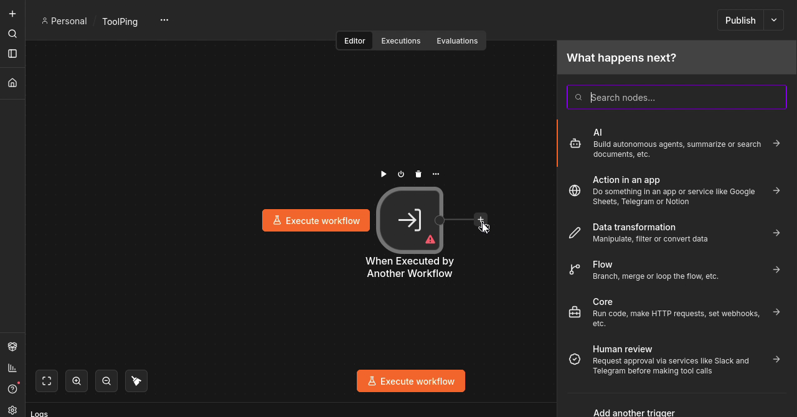
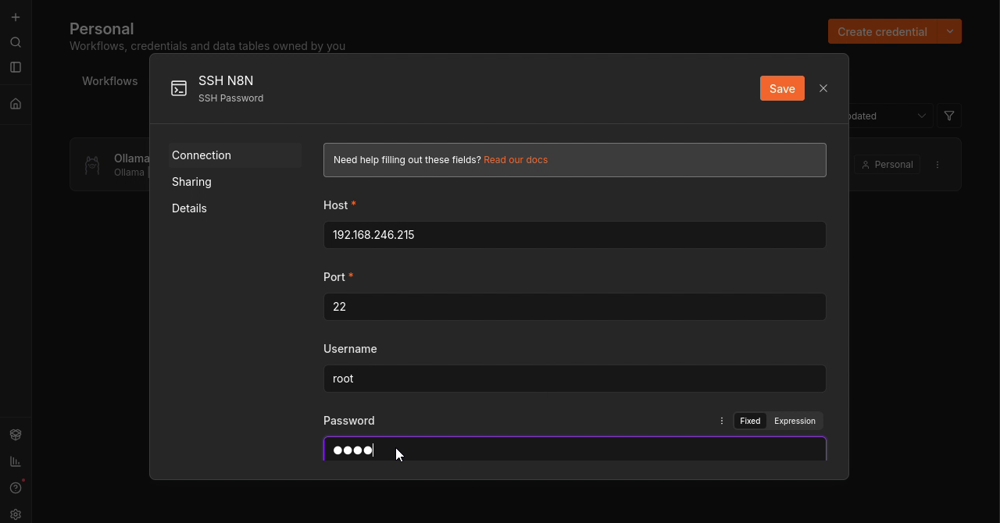
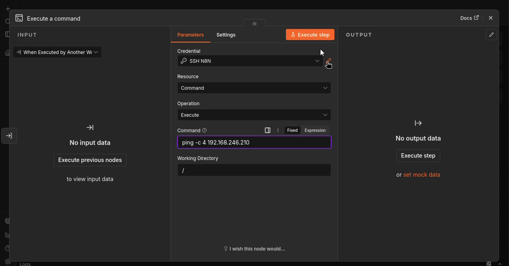
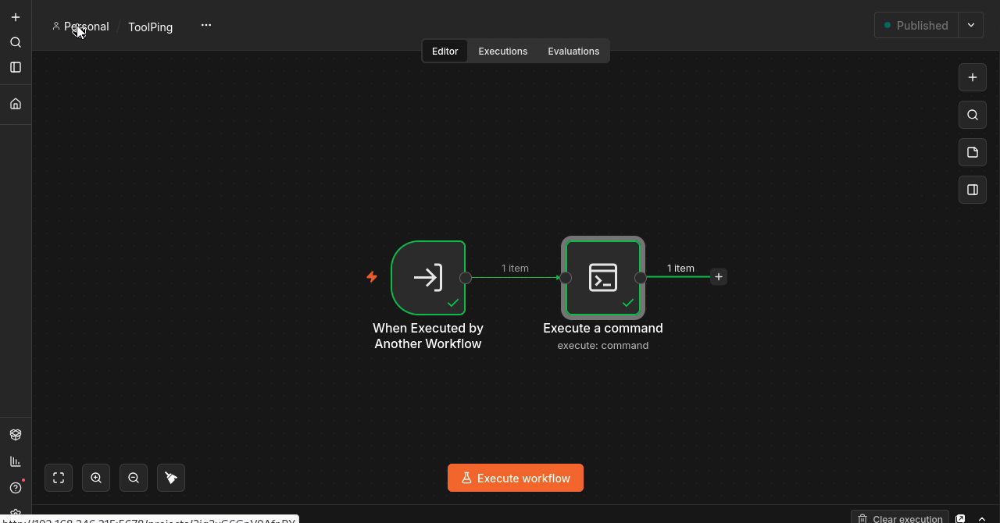
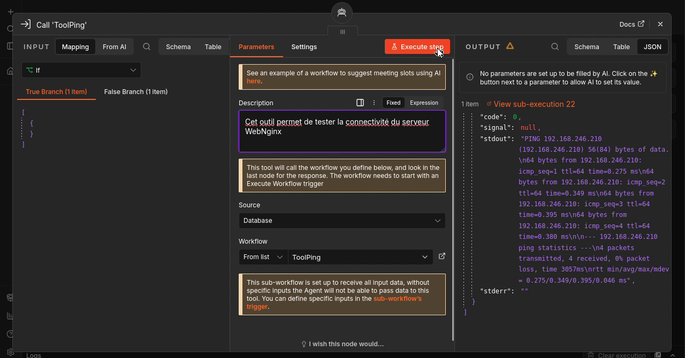

# Étape 4 — Créer et raccorder l’outil ping

**Objectif :** Construire ToolPing, corriger son déclencheur et le rendre accessible à l’agent.

🎬 [Lire ou télécharger la vidéo commentée](videos/Etape-04-video-commentee.mp4)

<video controls preload="metadata" width="960" src="videos/Etape-04-video-commentee.mp4">
  <a href="videos/Etape-04-video-commentee.mp4">Ouvrir la vidéo commentée</a>
</video>

## 1. Créer le sous-workflow ToolPing

1. Créer un nouveau workflow nommé ToolPing.
2. Ajouter When Executed by Another Workflow comme déclencheur.
3. Ajouter un nœud SSH avec l’action Execute a command.



*Capture à 00:33 dans la vidéo de cette étape (source complète : 06:00).*

**À retenir :** Ce sous-workflow sera appelé comme outil. Il ne remplace pas le déclencheur manuel du workflow principal.

## 2. Configurer SSH vers la machine n8n

1. Créer un identifiant SSH Password nommé SSH N8N.
2. Renseigner Host : 192.168.246.215 et Port : 22.
3. Saisir le compte et son mot de passe ; la vidéo utilise root pour ce laboratoire.
4. Enregistrer puis sélectionner SSH N8N dans le nœud SSH.



*Capture à 01:50 dans la vidéo de cette étape (source complète : 07:17).*

**À retenir :** Le ping est exécuté sur la machine jointe en SSH, ici le serveur n8n. Le mot de passe reste dans les identifiants n8n.

## 3. Lancer quatre requêtes ICMP

1. Conserver Resource : Command et Operation : Execute.
2. Saisir la commande ci-dessous et Working Directory : /.
3. Exécuter le nœud et lire le résultat de la commande.

```bash
ping -c 4 192.168.246.210
```



*Capture à 02:43 dans la vidéo de cette étape (source complète : 08:10).*

**À retenir :** -c 4 limite le test à quatre requêtes. Le ping vérifie la connectivité ICMP, pas le fonctionnement du serveur web.

## 4. Corriger le déclencheur et retester

1. Si le message At least 1 field is required apparaît, ouvrir le déclencheur.
2. Dans Input data mode, choisir Accept all data pour ce premier outil sans paramètres.
3. Enregistrer, puis relancer le sous-workflow.
4. Vérifier la réussite des deux nœuds.



*Capture à 03:33 dans la vidéo de cette étape (source complète : 09:00).*

**À retenir :** La commande contient une adresse fixe : aucun paramètre métier n’est demandé à l’agent. La correction évite de laisser une définition de champs vide.

## 5. Exposer ToolPing à l’agent

1. Dans DiagNginx, ajouter Call n8n Workflow Tool au connecteur Tool de AI Agent.
2. Choisir Source : Database puis Workflow : ToolPing.
3. Décrire la fonction : tester la connectivité du serveur WebNginx.
4. Tester l’outil : la sortie montrée contient code : 0, stdout avec quatre réponses et stderr vide.



*Capture à 04:38 dans la vidéo de cette étape (source complète : 10:05).*

**À retenir :** Le test direct valide l’outil. Il ne démontre pas encore que l’agent l’appelle spontanément : cette validation suivra la rédaction du prompt.

**Validation :** reproduire les manipulations et examiner les données retournées avant de passer à l’étape suivante.

[Retour au sommaire](README.md)
