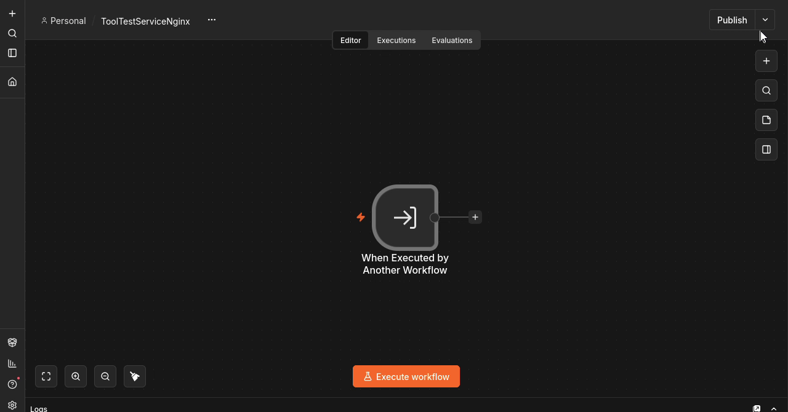
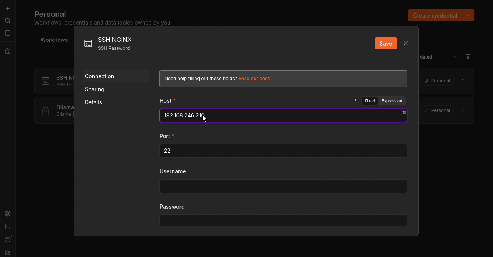
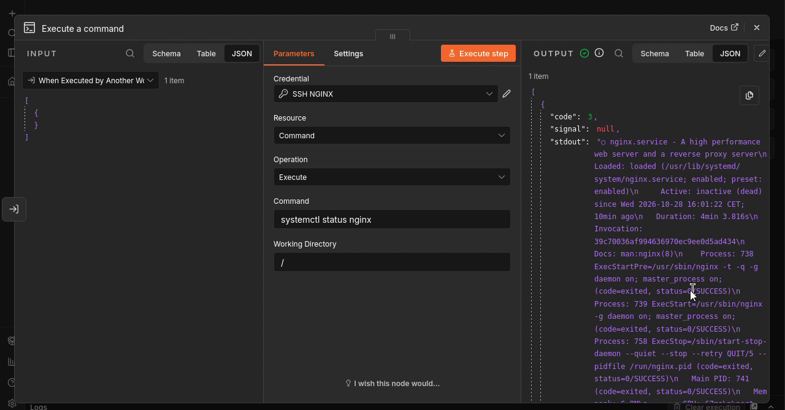

# Étape 5 — Contrôler le service Nginx par SSH

**Objectif :** Construire un outil qui consulte l’état du service directement sur le serveur web.

🎬 [Lire ou télécharger la vidéo commentée](videos/Etape-05-video-commentee.mp4)

<video controls preload="metadata" width="960" src="videos/Etape-05-video-commentee.mp4">
  <a href="videos/Etape-05-video-commentee.mp4">Ouvrir la vidéo commentée</a>
</video>

## 1. Créer ToolTestServiceNginx

1. Créer un workflow nommé ToolTestServiceNginx.
2. Ajouter When Executed by Another Workflow.
3. Configurer Input data mode : Accept all data pour cet outil sans paramètres.



*Capture à 00:35 dans la vidéo de cette étape (source complète : 11:03).*

**À retenir :** Comme pour ToolPing, la cible et la commande seront fixées dans le sous-workflow.

## 2. Créer les identifiants du serveur web

1. Créer un identifiant SSH Password nommé SSH NGINX.
2. Renseigner Host : 192.168.246.210 et Port : 22.
3. Saisir le compte du laboratoire et son mot de passe.
4. Enregistrer les identifiants.



*Capture à 01:32 dans la vidéo de cette étape (source complète : 12:00).*

**À retenir :** Cette connexion vise le serveur Nginx. Ne pas la confondre avec SSH N8N, utilisé pour exécuter le ping depuis la machine n8n.

## 3. Exécuter et interpréter systemctl

1. Ajouter SSH > Execute a command au sous-workflow.
2. Sélectionner SSH NGINX, Resource : Command et Operation : Execute.
3. Saisir systemctl status nginx et Working Directory : /.
4. Exécuter le nœud et lire stdout ainsi que code.

```bash
systemctl status nginx
```



*Capture à 02:52 dans la vidéo de cette étape (source complète : 13:20).*

**À retenir :** Dans la vidéo, le résultat contient code : 3 et Active: inactive (dead). La commande a permis d’observer un service arrêté ; une pastille verte n’indique donc pas que Nginx est actif.

**Validation :** reproduire les manipulations et examiner les données retournées avant de passer à l’étape suivante.

[Retour au sommaire](README.md)
