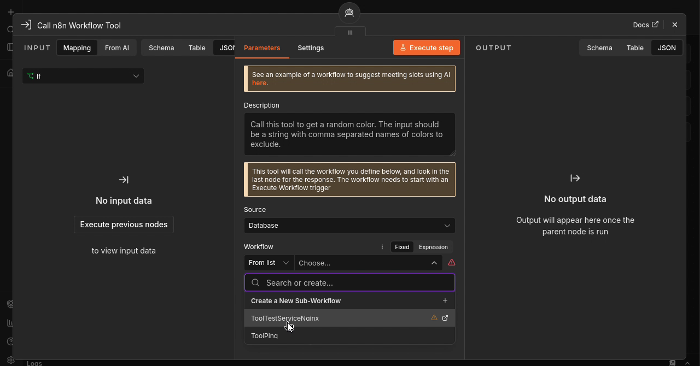
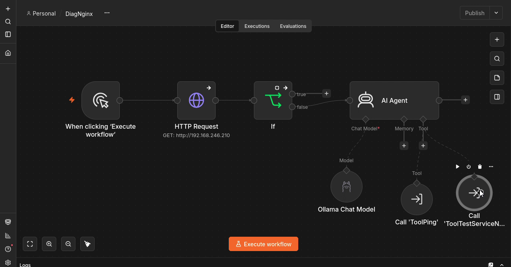
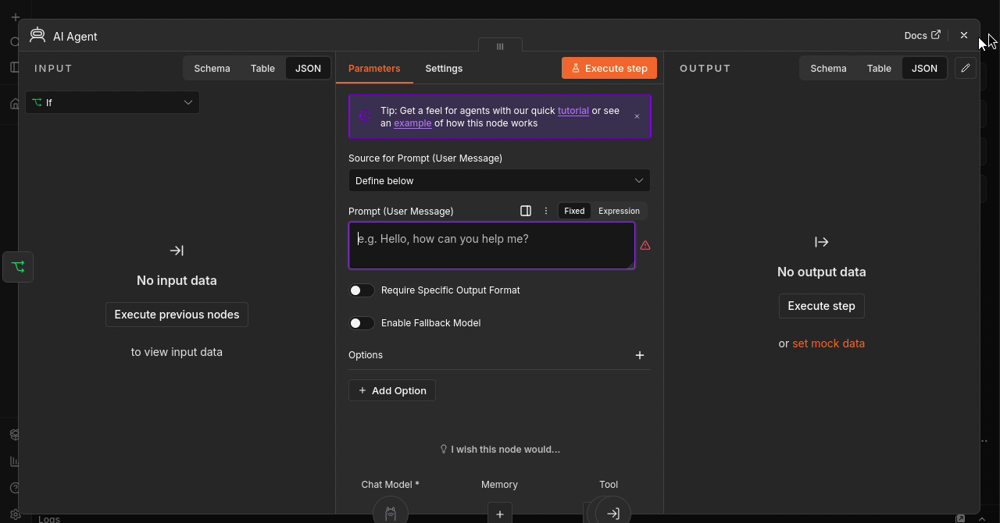

# Étape 6 — Raccorder le second outil et préparer le prompt

**Objectif :** Finaliser les raccordements et identifier les vérifications restant à réaliser.

🎬 [Lire ou télécharger la vidéo commentée](videos/Etape-06-video-commentee.mp4)

<video controls preload="metadata" width="960" src="videos/Etape-06-video-commentee.mp4">
  <a href="videos/Etape-06-video-commentee.mp4">Ouvrir la vidéo commentée</a>
</video>

## 1. Raccorder le contrôle du service

1. Revenir dans DiagNginx.
2. Utiliser le connecteur Tool de AI Agent et ajouter Call n8n Workflow Tool.
3. Choisir Source : Database puis ToolTestServiceNginx.

*Capture à 00:27 dans la vidéo de cette étape (source complète : 14:05).*

**À retenir :** Le panneau Memory apparaît brièvement dans la vidéo, mais ce contrôle doit être raccordé à Tool. Aucune mémoire n’est ajoutée dans le montage final.

## 2. Décrire et vérifier les deux outils

1. Décrire le second outil : vérifier si le service Nginx est démarré.
2. Vérifier que ToolPing et ToolTestServiceNginx sont reliés à Tool.
3. Vérifier que Ollama Chat Model est relié à Chat Model et IF False à l’entrée de l’agent.

*Capture à 01:12 dans la vidéo de cette étape (source complète : 14:50).*

**À retenir :** Les deux outils répondent à deux questions distinctes : la machine répond-elle au ping ? Le service Nginx est-il actif ?

## 3. Point d’arrêt : prompt à compléter

1. Ouvrir AI Agent et choisir Source for Prompt : Define below.
2. Le champ Prompt (User Message) est encore vide à la fin de la vidéo.
3. Prévoir ensuite une consigne définissant le diagnostic, l’usage des deux outils et le format du retour.
4. Tester le scénario complet après saisie du prompt.

*Capture à 01:30 dans la vidéo de cette étape (source complète : 15:08).*

**À retenir :** La vidéo ne montre ni prompt final ni diagnostic autonome complet. Les tests futurs devront distinguer : serveur disponible, service arrêté, absence de réponse ICMP et échec de connexion SSH.

**Validation :** reproduire les manipulations et examiner les données retournées avant de passer à l’étape suivante.

[Retour au sommaire](README.md)
