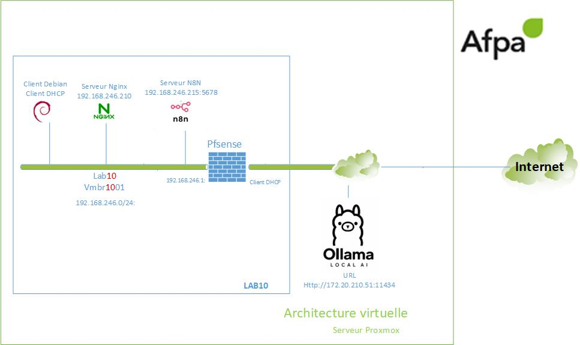

# Lab n8n — Initiation à la création d'un agent IA avec N8N
# L'ensemble du contenu et mise en forme est généré par IA à partir d'une capture Video sans commentaire.

Six étapes pour construire un diagnostic Nginx avec n8n, Ollama et deux outils appelant des sous-workflows.
Ce lab ne couvre pas l'installation de N8N et Ollama
Schéma du LAB.

[Consulter le tutoriel intégral](Tutoriel-complet.md)

## Parcours

| Étape | Markdown illustré | Vidéo commentée |
|---|---|---|
| 1. Créer le premier test HTTP | [Tutoriel](Etape-01-tutoriel.md) | [Vidéo](videos/Etape-01-video-commentee.mp4) |
| 2. Configurer IF et tester l’arrêt de Nginx | [Tutoriel](Etape-02-tutoriel.md) | [Vidéo](videos/Etape-02-video-commentee.mp4) |
| 3. Connecter l’agent IA à Ollama | [Tutoriel](Etape-03-tutoriel.md) | [Vidéo](videos/Etape-03-video-commentee.mp4) |
| 4. Créer et raccorder l’outil ping | [Tutoriel](Etape-04-tutoriel.md) | [Vidéo](videos/Etape-04-video-commentee.mp4) |
| 5. Contrôler le service Nginx par SSH | [Tutoriel](Etape-05-tutoriel.md) | [Vidéo](videos/Etape-05-video-commentee.mp4) |
| 6. Raccorder le second outil et préparer le prompt | [Tutoriel](Etape-06-tutoriel.md) | [Vidéo](videos/Etape-06-video-commentee.mp4) |

