# Lab n8n — Tutoriel intégral

[Retour au sommaire](README.md)

# Étape 1 — Créer le premier test HTTP

**Objectif :** Créer un workflow manuel et vérifier la réponse HTTP du serveur Nginx.

🎬 [Lire ou télécharger la vidéo commentée](videos/Etape-01-video-commentee.mp4)

<video controls preload="metadata" width="960" src="videos/Etape-01-video-commentee.mp4">
  <a href="videos/Etape-01-video-commentee.mp4">Ouvrir la vidéo commentée</a>
</video>

## 1. Créer le workflow et son déclencheur

1. Nommer le workflow DiagNginx.
2. Cliquer sur Add first step, puis Trigger manually.
3. Utiliser ce déclencheur pour lancer les essais à la demande.

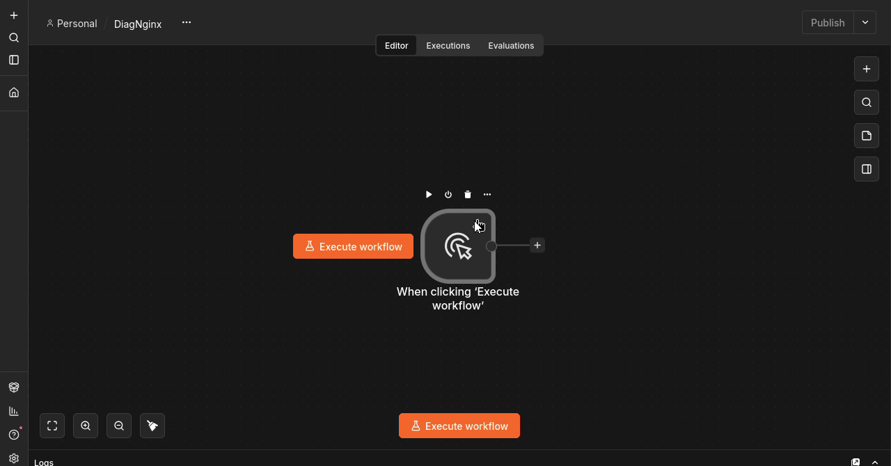

*Capture à 00:19 dans la vidéo de cette étape (source complète : 00:19).*

**À retenir :** Le test part de n8n : le serveur doit être accessible depuis son environnement d’exécution.

## 2. Configurer la requête HTTP

1. Ajouter HTTP Request à la sortie du déclencheur.
2. Choisir GET et saisir http://192.168.246.210.
3. Conserver Authentication : None pour la page de test du laboratoire.

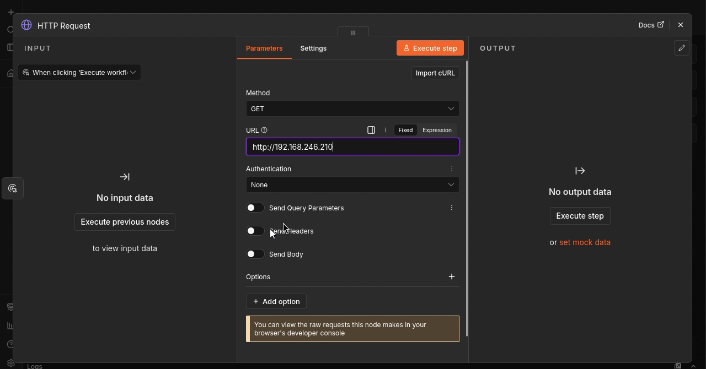

*Capture à 00:41 dans la vidéo de cette étape (source complète : 00:41).*

**À retenir :** Adapter l’adresse IP à votre installation. GET demande le contenu de la page.

## 3. Récupérer et tester la réponse

1. Dans Options > Response, activer Include Response Headers and Status.
2. Conserver Response Format : Autodetect et Never Error désactivé.
3. Dans Settings, régler On Error sur Continue.
4. Exécuter le nœud et repérer statusCode : 200 et statusMessage : OK.

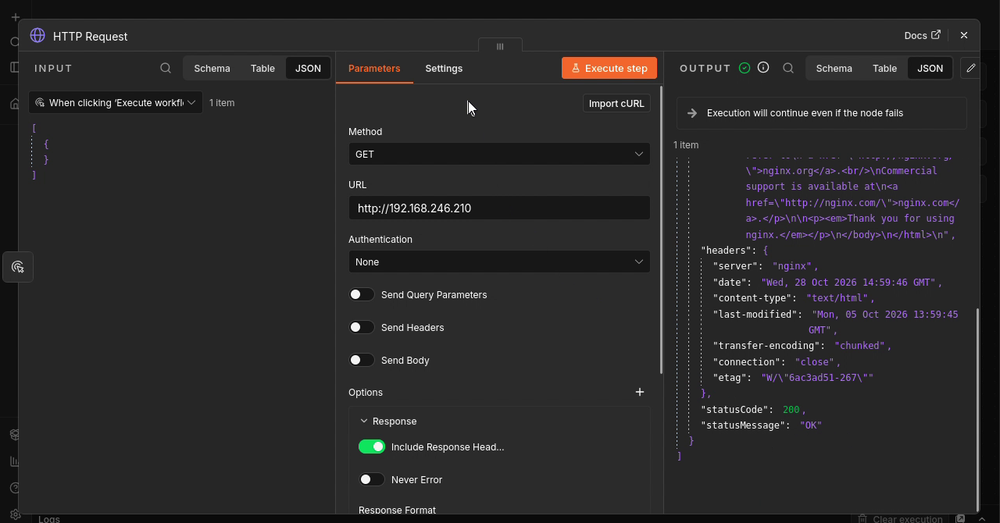

*Capture à 01:08 dans la vidéo de cette étape (source complète : 01:08).*

**À retenir :** Continue permet de poursuivre après une erreur ; ce réglage ne transforme pas un échec en succès.

**Validation :** reproduire les manipulations et examiner les données retournées avant de passer à l’étape suivante.


---

# Étape 2 — Configurer IF et tester l’arrêt de Nginx

**Objectif :** Comparer le code HTTP à 200, puis vérifier les branches true et false en arrêtant volontairement Nginx.

🎬 [Lire ou télécharger la vidéo commentée](videos/Etape-02-video-commentee.mp4)

<video controls preload="metadata" width="960" src="videos/Etape-02-video-commentee.mp4">
  <a href="videos/Etape-02-video-commentee.mp4">Ouvrir la vidéo commentée</a>
</video>

Version corrigée du 1er novembre 2026 : la commande d’arrêt du service est montrée avant le test d’échec.

## 1. Ajouter le nœud IF

À droite de **HTTP Request**, cliquez sur **+**, recherchez **IF** et sélectionnez-le. Le flux devient : déclencheur manuel → HTTP Request → IF.

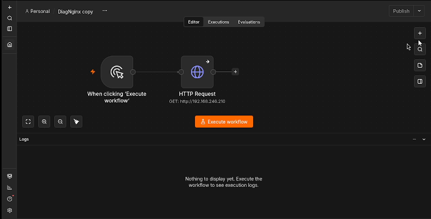

*Capture à 00:02 dans la vidéo de cette étape.*

## 2. Charger les données de la requête

Exécutez les étapes précédentes, puis ouvrez IF. Dans **INPUT / JSON**, repérez **statusCode**. Le premier résultat contient ici la valeur **200** et le message **OK**.

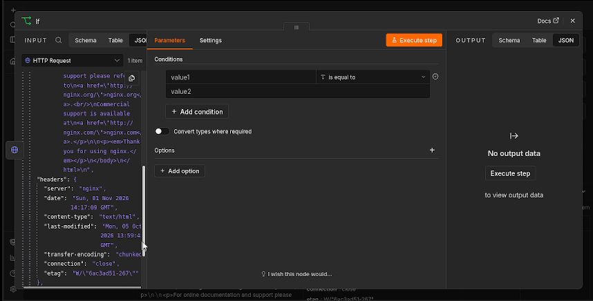

*Capture à 00:28 dans la vidéo de cette étape.*

## 3. Comparer statusCode à 200

Dans **Parameters**, utilisez **{{ $json.statusCode }}** comme première valeur. Sélectionnez le type **Number** et **is equal to**, puis saisissez **200** comme seconde valeur.

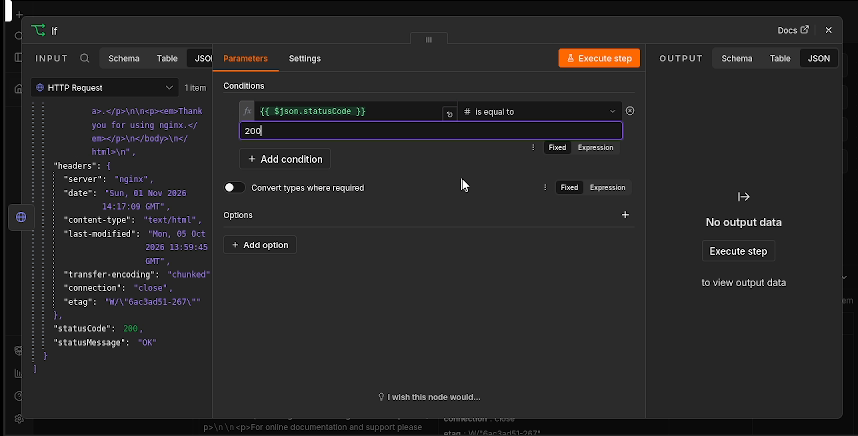

*Capture à 00:39 dans la vidéo de cette étape.*

## 4. Repérer le réglage de gestion des erreurs

La vidéo sélectionne **Settings → On Error → Continue** sur IF. Ce réglage concerne les erreurs de ce nœud. Pour que les erreurs réseau parviennent à IF, **HTTP Request** doit lui aussi continuer en cas d’erreur, comme préparé à l’étape 1.

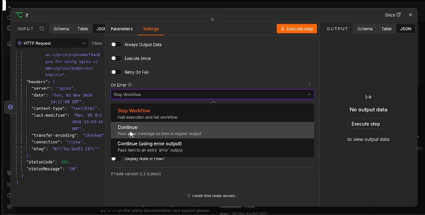

*Capture à 00:45 dans la vidéo de cette étape.*

## 5. Réponse HTTP 200 : branche true

Lancez **Execute workflow**. Le premier test affiche **True Branch (1 item)** avec **statusCode = 200**. Cette page répond correctement ; cela ne valide pas tous les services du serveur.

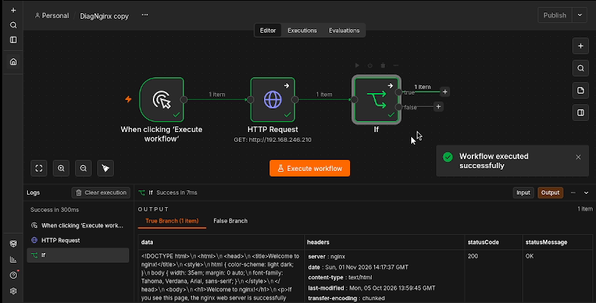

*Capture à 00:51 dans la vidéo de cette étape.*

## 6. Arrêter Nginx pour simuler la panne

Ouvrez la console de la VM **NGINX**. Avec le compte **root**, exécutez **systemctl stop nginx**. Avec un compte autorisé utilisant sudo : **sudo systemctl stop nginx**. La commande doit être lancée sur le serveur web, pas sur le serveur n8n.

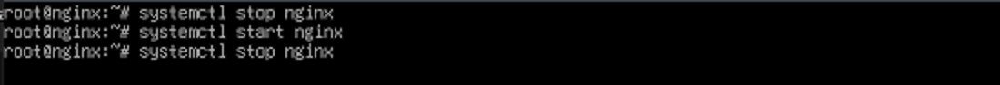

*Capture à 01:01 dans la vidéo de cette étape.*

## 7. Relancer le workflow et lire le résultat

Cliquez sur **Execute workflow**. La sortie affiche **False Branch (1 item)** avec **ECONNREFUSED** sur le port 80. Dans ce test, la panne a été provoquée par l’arrêt volontaire de Nginx.

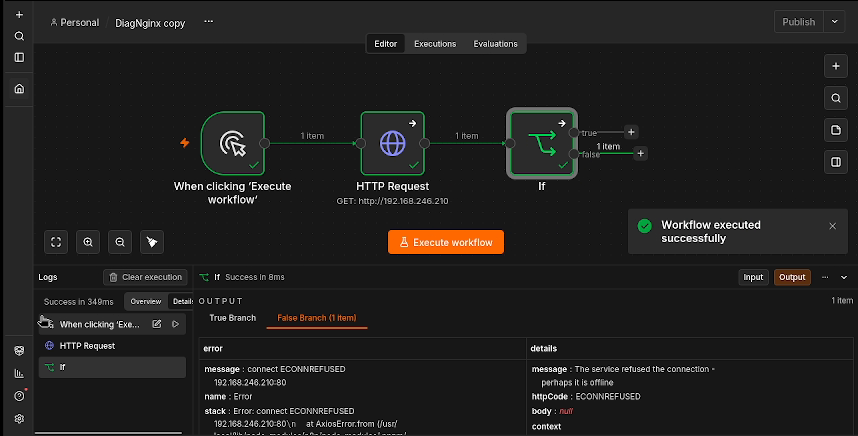

*Capture à 01:11 dans la vidéo de cette étape.*

## Commandes du test

À exécuter sur le **serveur Nginx**, avec le compte root :

```bash
systemctl stop nginx
```

Avec un compte autorisé utilisant sudo :

```bash
sudo systemctl stop nginx
```

## Interpréter les résultats

| Résultat | Branche | Interprétation |
|---|---|---|
| `statusCode = 200` | `true` | La page demandée répond correctement. |
| `ECONNREFUSED` après l’arrêt de Nginx | `false` | La connexion au service web est refusée. |
| `Workflow executed successfully` | — | n8n a terminé son exécution ; ce message ne prouve pas que Nginx est disponible. |

## Après l’exercice : remettre le service en marche

Complément au tutoriel, non réalisé à la fin de cet extrait :

```bash
systemctl start nginx
```

Ou, avec un compte utilisant sudo :

```bash
sudo systemctl start nginx
```

Relancez ensuite le workflow : une réponse 200 doit revenir dans `true`. Si la suite du lab nécessite la panne, conservez le service arrêté jusqu’à la fin du diagnostic.


---

# Étape 3 — Connecter l’agent IA à Ollama

**Objectif :** Ajouter l’agent sur la branche de diagnostic et lui associer un modèle Ollama.

🎬 [Lire ou télécharger la vidéo commentée](videos/Etape-03-video-commentee.mp4)

<video controls preload="metadata" width="960" src="videos/Etape-03-video-commentee.mp4">
  <a href="videos/Etape-03-video-commentee.mp4">Ouvrir la vidéo commentée</a>
</video>

## 1. Ajouter l’agent sur la branche False

1. Ajouter AI Agent dans le workflow DiagNginx.
2. Relier la sortie False du nœud IF à l’entrée de l’agent.
3. Réserver la sortie True au cas où la réponse HTTP est conforme.

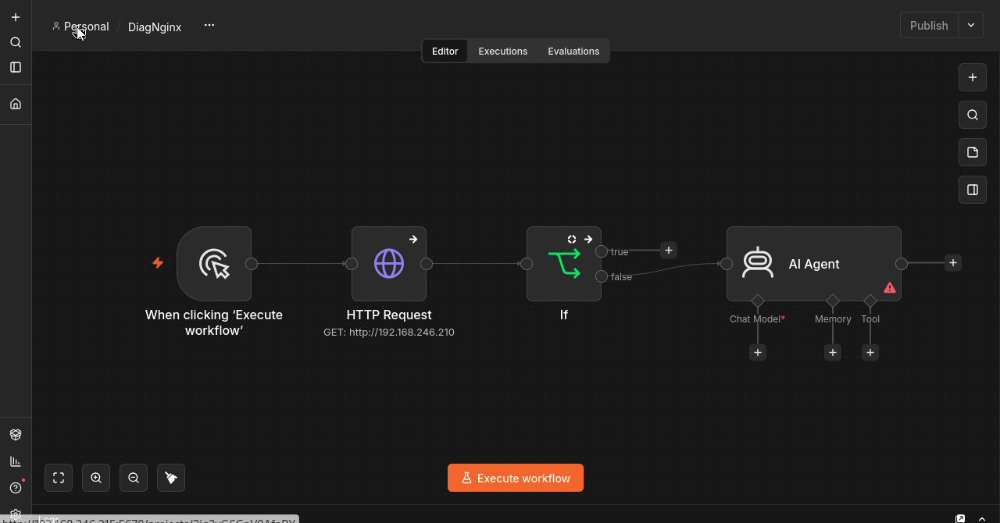

*Capture à 00:30 dans la vidéo de cette étape (source complète : 03:30).*

**À retenir :** Le raccordement prépare le diagnostic. Le prompt final de l’agent n’est pas saisi dans cette vidéo.

## 2. Créer la connexion Ollama

1. Dans Credentials, créer un identifiant de type Ollama.
2. Saisir la Base URL : http://172.20.210.51:11434.
3. Laisser API Key vide pour cette installation locale sans authentification.
4. Enregistrer et vérifier Connection tested successfully.

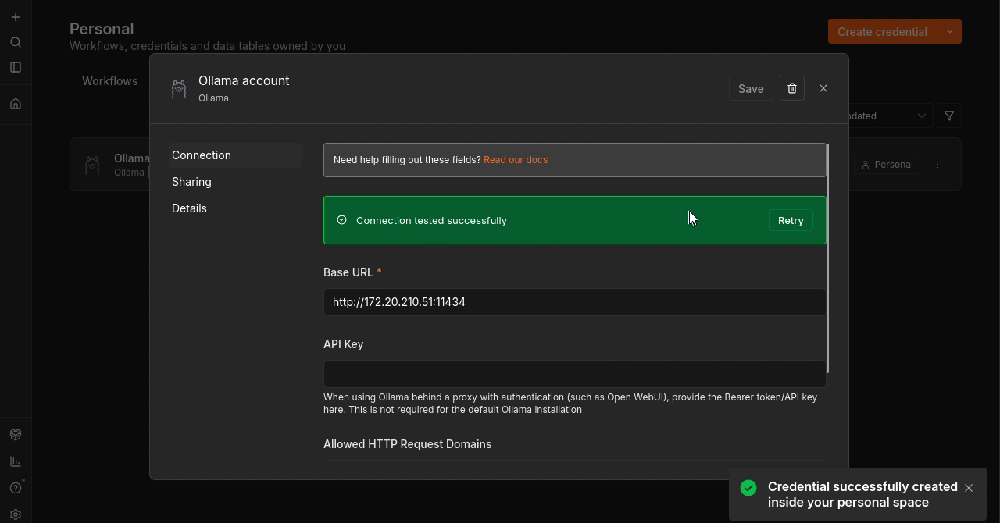

*Capture à 01:32 dans la vidéo de cette étape (source complète : 04:32).*

**À retenir :** Utiliser l’adresse de votre serveur Ollama, accessible depuis n8n. localhost désignerait l’environnement de n8n, pas nécessairement la machine Ollama.

## 3. Associer le modèle à l’agent

1. Depuis le connecteur Chat Model de AI Agent, ajouter Ollama Chat Model.
2. Sélectionner l’identifiant Ollama account.
3. Choisir un modèle disponible dans la liste ; la vidéo affiche notamment llama3.2:latest.
4. Vérifier le lien entre Ollama Chat Model et le connecteur Chat Model de l’agent.

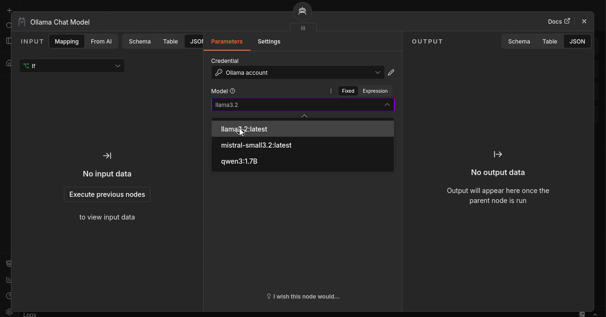

*Capture à 02:04 dans la vidéo de cette étape (source complète : 05:04).*

**À retenir :** La connexion réussie valide l’accès à Ollama. L’appel effectif des outils par le modèle devra être testé une fois le prompt renseigné.

**Validation :** reproduire les manipulations et examiner les données retournées avant de passer à l’étape suivante.


---

# Étape 4 — Créer et raccorder l’outil ping

**Objectif :** Construire ToolPing, corriger son déclencheur et le rendre accessible à l’agent.

🎬 [Lire ou télécharger la vidéo commentée](videos/Etape-04-video-commentee.mp4)

<video controls preload="metadata" width="960" src="videos/Etape-04-video-commentee.mp4">
  <a href="videos/Etape-04-video-commentee.mp4">Ouvrir la vidéo commentée</a>
</video>

## 1. Créer le sous-workflow ToolPing

1. Créer un nouveau workflow nommé ToolPing.
2. Ajouter When Executed by Another Workflow comme déclencheur.
3. Ajouter un nœud SSH avec l’action Execute a command.

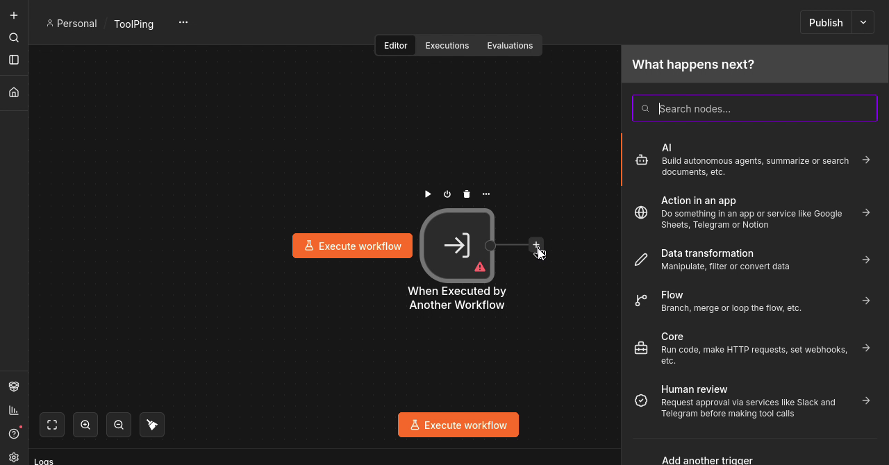

*Capture à 00:33 dans la vidéo de cette étape (source complète : 06:00).*

**À retenir :** Ce sous-workflow sera appelé comme outil. Il ne remplace pas le déclencheur manuel du workflow principal.

## 2. Configurer SSH vers la machine n8n

1. Créer un identifiant SSH Password nommé SSH N8N.
2. Renseigner Host : 192.168.246.215 et Port : 22.
3. Saisir le compte et son mot de passe ; la vidéo utilise root pour ce laboratoire.
4. Enregistrer puis sélectionner SSH N8N dans le nœud SSH.

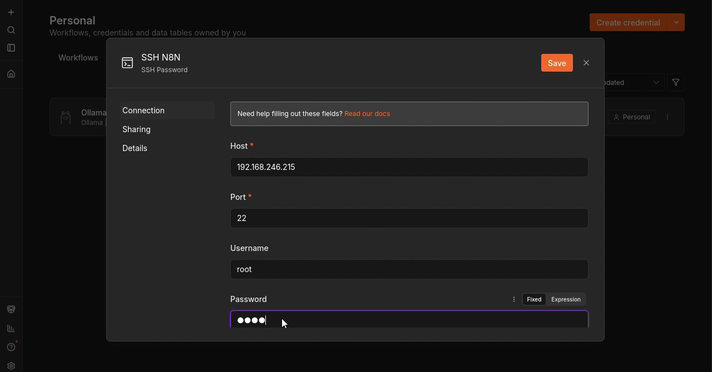

*Capture à 01:50 dans la vidéo de cette étape (source complète : 07:17).*

**À retenir :** Le ping est exécuté sur la machine jointe en SSH, ici le serveur n8n. Le mot de passe reste dans les identifiants n8n.

## 3. Lancer quatre requêtes ICMP

1. Conserver Resource : Command et Operation : Execute.
2. Saisir la commande ci-dessous et Working Directory : /.
3. Exécuter le nœud et lire le résultat de la commande.

```bash
ping -c 4 192.168.246.210
```

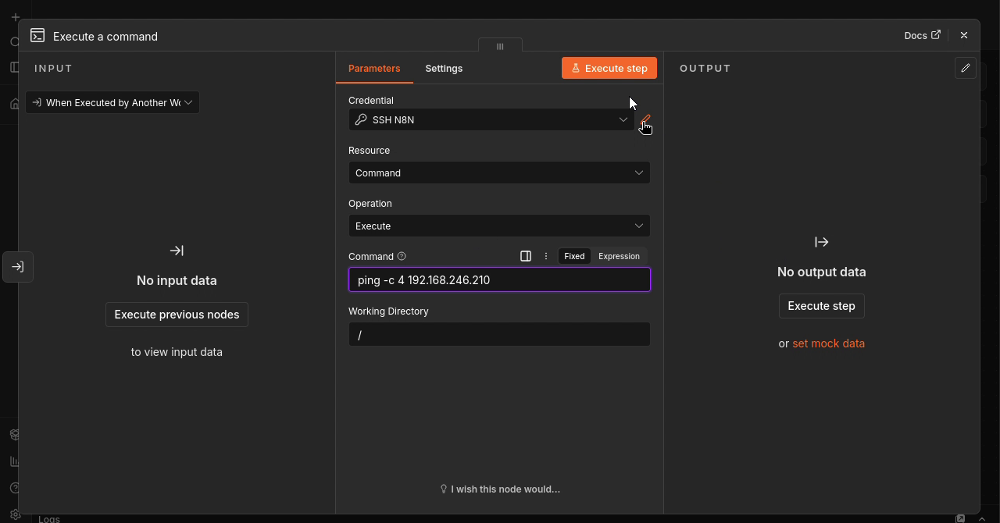

*Capture à 02:43 dans la vidéo de cette étape (source complète : 08:10).*

**À retenir :** -c 4 limite le test à quatre requêtes. Le ping vérifie la connectivité ICMP, pas le fonctionnement du serveur web.

## 4. Corriger le déclencheur et retester

1. Si le message At least 1 field is required apparaît, ouvrir le déclencheur.
2. Dans Input data mode, choisir Accept all data pour ce premier outil sans paramètres.
3. Enregistrer, puis relancer le sous-workflow.
4. Vérifier la réussite des deux nœuds.

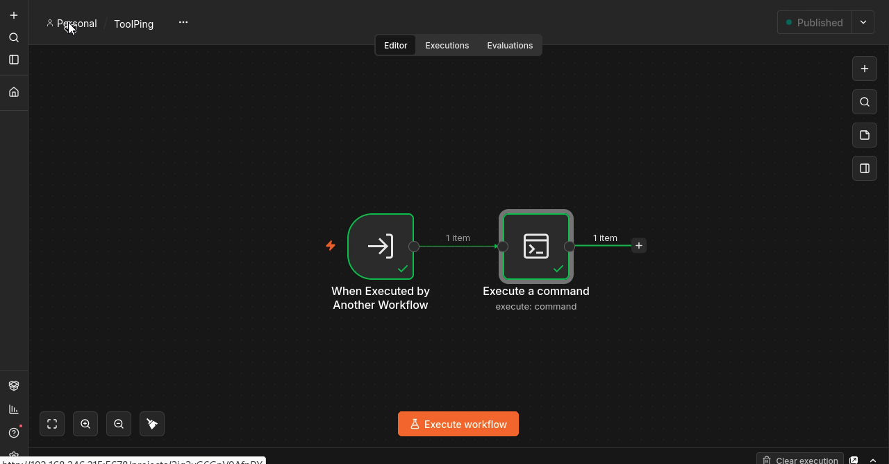

*Capture à 03:33 dans la vidéo de cette étape (source complète : 09:00).*

**À retenir :** La commande contient une adresse fixe : aucun paramètre métier n’est demandé à l’agent. La correction évite de laisser une définition de champs vide.

## 5. Exposer ToolPing à l’agent

1. Dans DiagNginx, ajouter Call n8n Workflow Tool au connecteur Tool de AI Agent.
2. Choisir Source : Database puis Workflow : ToolPing.
3. Décrire la fonction : tester la connectivité du serveur WebNginx.
4. Tester l’outil : la sortie montrée contient code : 0, stdout avec quatre réponses et stderr vide.

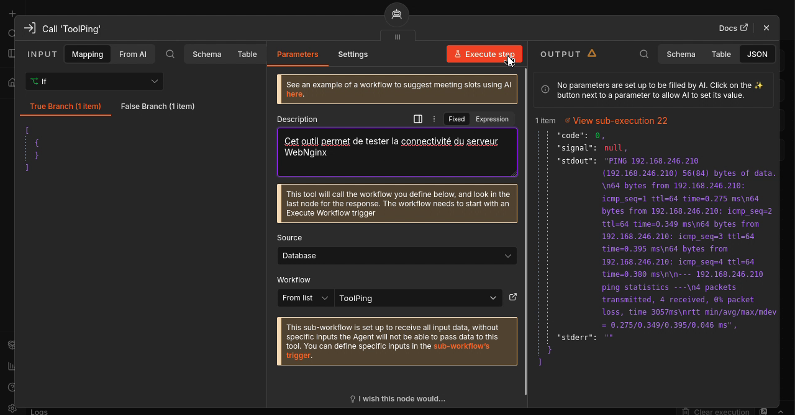

*Capture à 04:38 dans la vidéo de cette étape (source complète : 10:05).*

**À retenir :** Le test direct valide l’outil. Il ne démontre pas encore que l’agent l’appelle spontanément : cette validation suivra la rédaction du prompt.

**Validation :** reproduire les manipulations et examiner les données retournées avant de passer à l’étape suivante.


---

# Étape 5 — Contrôler le service Nginx par SSH

**Objectif :** Construire un outil qui consulte l’état du service directement sur le serveur web.

🎬 [Lire ou télécharger la vidéo commentée](videos/Etape-05-video-commentee.mp4)

<video controls preload="metadata" width="960" src="videos/Etape-05-video-commentee.mp4">
  <a href="videos/Etape-05-video-commentee.mp4">Ouvrir la vidéo commentée</a>
</video>

## 1. Créer ToolTestServiceNginx

1. Créer un workflow nommé ToolTestServiceNginx.
2. Ajouter When Executed by Another Workflow.
3. Configurer Input data mode : Accept all data pour cet outil sans paramètres.

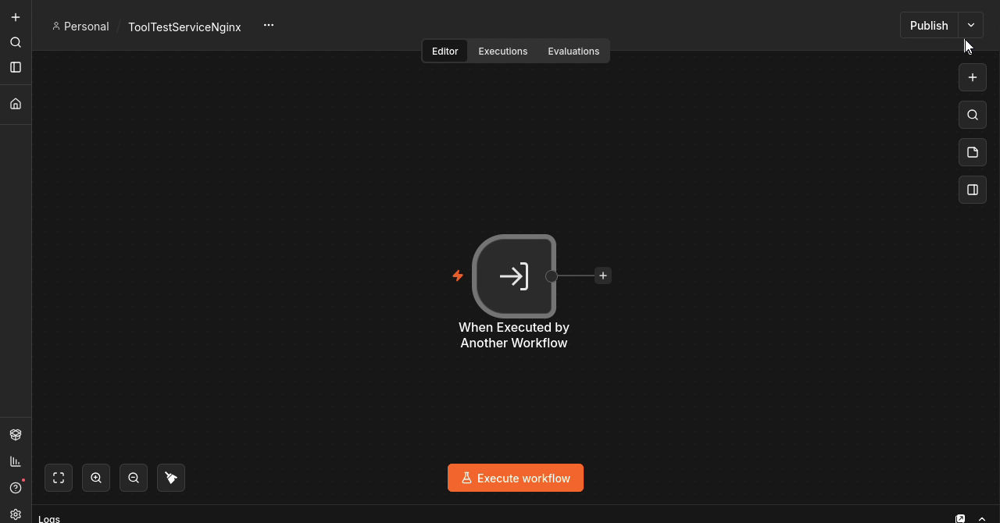

*Capture à 00:35 dans la vidéo de cette étape (source complète : 11:03).*

**À retenir :** Comme pour ToolPing, la cible et la commande seront fixées dans le sous-workflow.

## 2. Créer les identifiants du serveur web

1. Créer un identifiant SSH Password nommé SSH NGINX.
2. Renseigner Host : 192.168.246.210 et Port : 22.
3. Saisir le compte du laboratoire et son mot de passe.
4. Enregistrer les identifiants.

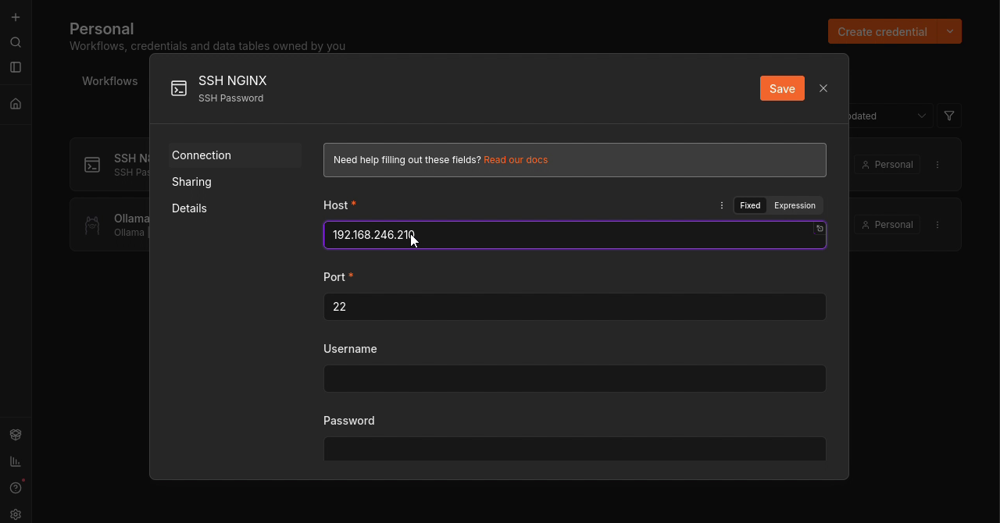

*Capture à 01:32 dans la vidéo de cette étape (source complète : 12:00).*

**À retenir :** Cette connexion vise le serveur Nginx. Ne pas la confondre avec SSH N8N, utilisé pour exécuter le ping depuis la machine n8n.

## 3. Exécuter et interpréter systemctl

1. Ajouter SSH > Execute a command au sous-workflow.
2. Sélectionner SSH NGINX, Resource : Command et Operation : Execute.
3. Saisir systemctl status nginx et Working Directory : /.
4. Exécuter le nœud et lire stdout ainsi que code.

```bash
systemctl status nginx
```

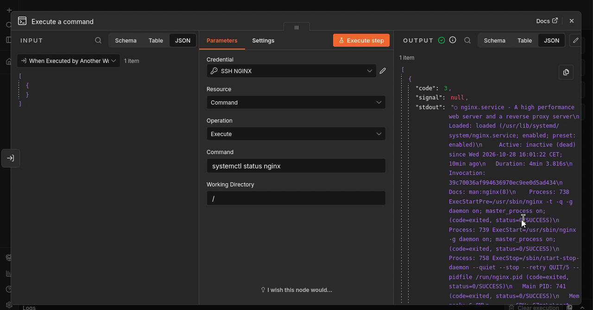

*Capture à 02:52 dans la vidéo de cette étape (source complète : 13:20).*

**À retenir :** Dans la vidéo, le résultat contient code : 3 et Active: inactive (dead). La commande a permis d’observer un service arrêté ; une pastille verte n’indique donc pas que Nginx est actif.

**Validation :** reproduire les manipulations et examiner les données retournées avant de passer à l’étape suivante.


---

# Étape 6 — Raccorder le second outil et préparer le prompt

**Objectif :** Finaliser les raccordements et identifier les vérifications restant à réaliser.

🎬 [Lire ou télécharger la vidéo commentée](videos/Etape-06-video-commentee.mp4)

<video controls preload="metadata" width="960" src="videos/Etape-06-video-commentee.mp4">
  <a href="videos/Etape-06-video-commentee.mp4">Ouvrir la vidéo commentée</a>
</video>

## 1. Raccorder le contrôle du service

1. Revenir dans DiagNginx.
2. Utiliser le connecteur Tool de AI Agent et ajouter Call n8n Workflow Tool.
3. Choisir Source : Database puis ToolTestServiceNginx.

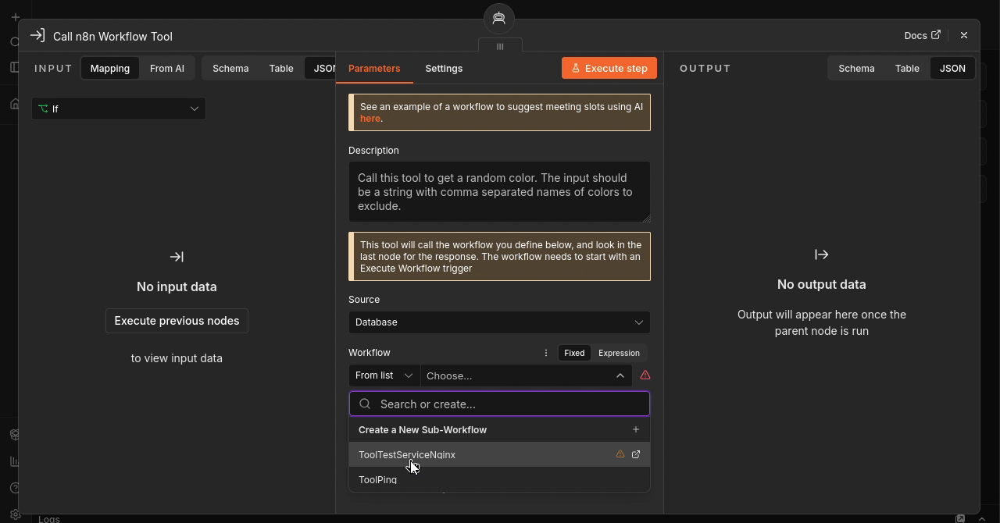

*Capture à 00:27 dans la vidéo de cette étape (source complète : 14:05).*

**À retenir :** Le panneau Memory apparaît brièvement dans la vidéo, mais ce contrôle doit être raccordé à Tool. Aucune mémoire n’est ajoutée dans le montage final.

## 2. Décrire et vérifier les deux outils

1. Décrire le second outil : vérifier si le service Nginx est démarré.
2. Vérifier que ToolPing et ToolTestServiceNginx sont reliés à Tool.
3. Vérifier que Ollama Chat Model est relié à Chat Model et IF False à l’entrée de l’agent.

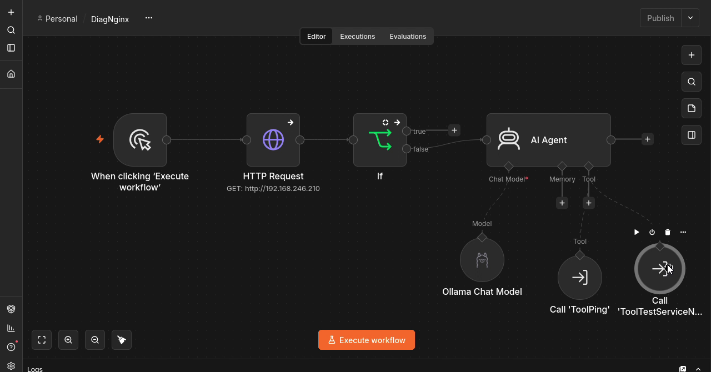

*Capture à 01:12 dans la vidéo de cette étape (source complète : 14:50).*

**À retenir :** Les deux outils répondent à deux questions distinctes : la machine répond-elle au ping ? Le service Nginx est-il actif ?

## 3. Point d’arrêt : prompt à compléter

1. Ouvrir AI Agent et choisir Source for Prompt : Define below.
2. Le champ Prompt (User Message) est encore vide à la fin de la vidéo.
3. Prévoir ensuite une consigne définissant le diagnostic, l’usage des deux outils et le format du retour.
4. Tester le scénario complet après saisie du prompt.

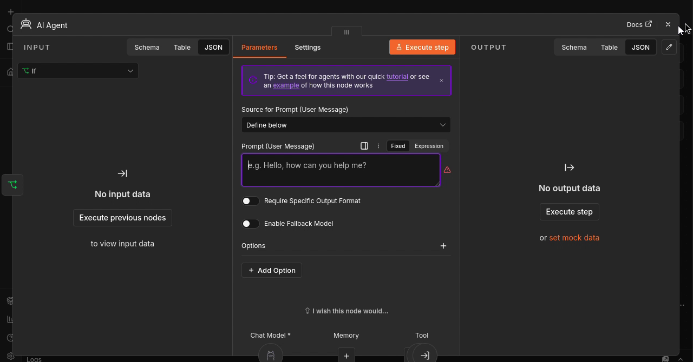

*Capture à 01:30 dans la vidéo de cette étape (source complète : 15:08).*
Réponds de manière courte et technique.

**À retenir :** La vidéo ne montre ni prompt final ni diagnostic autonome complet. Les tests futurs devront distinguer : serveur disponible, service arrêté, absence de réponse ICMP et échec de connexion SSH.

**Validation :** reproduire les manipulations et examiner les données retournées avant de passer à l’étape suivante.

## Exemple de prompt
Tu es un agent IA chargé d’aider à diagnostiquer un serveur Nginx.

Tu disposes de deux outils :

ToolPing : teste la connectivité réseau avec le serveur Nginx.

ToolServiceNginx : vérifie l’état du service Nginx avec la commande systemctl status nginx.

Lorsqu’un problème est signalé :

utilise les outils disponibles pour récupérer des informations ;

analyse leurs résultats ;

indique la cause probable du problème ;

propose une action simple à l’administrateur.

Ne suppose pas le résultat d’un outil sans l’avoir utilisé.


